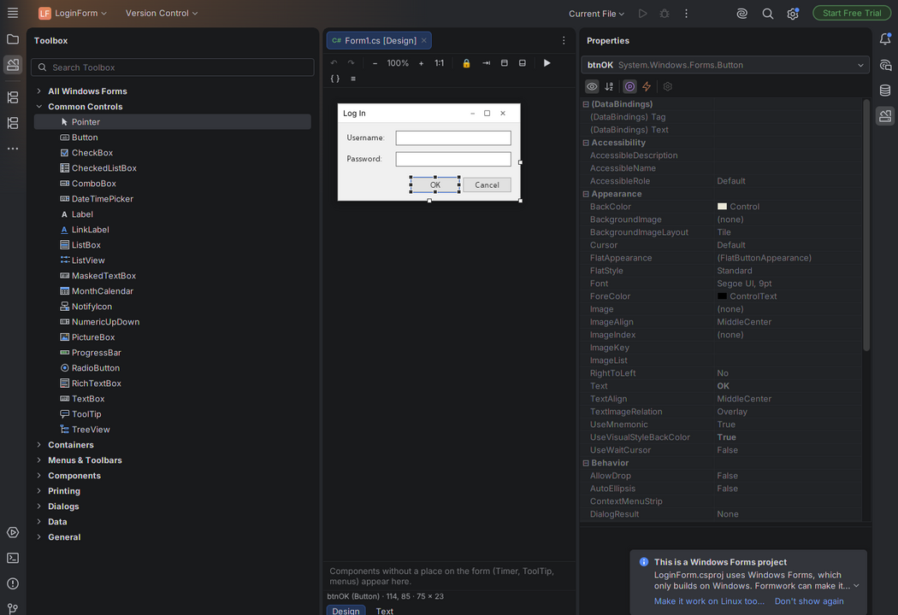
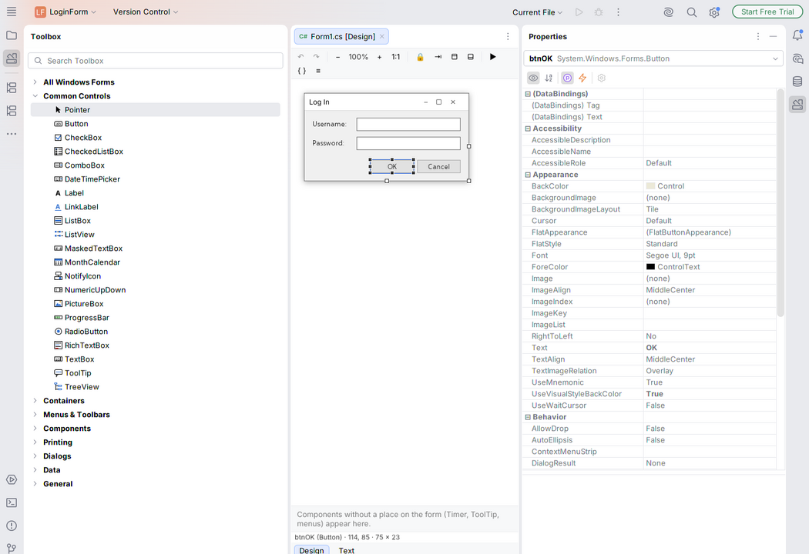

# Formwork

**The Windows Forms designer for JetBrains Rider on Linux**, laid out and behaving like the one in
Visual Studio 2022: a `Form1.cs [Design]` tab, a docked **Toolbox**, a **Properties** window with
**Events**, **Document Outline**, a **Format** menu, F7 / Shift+F7, double-click a control to get
`button1_Click`.

Your code stays exactly as Visual Studio writes it — the same `Program.cs`, `Form1.cs`,
`Form1.Designer.cs` and `InitializeComponent()` — so a form designed at home on Linux opens unchanged in
Visual Studio at college, and the other way round.

| Dark theme | Light theme |
|---|---|
|  |  |

*(Screenshots are from the sandbox IntelliJ IDEA 2026.2, the same platform Rider 2026.2 is built on;
see "Status" below.)*

## How it works

Formwork stands on **[NetForms](https://github.com/Go-Forms/.NetForms)** (MIT licence), a
reimplementation of `System.Windows.Forms` for .NET 10 that runs on Linux.

- NetForms' **designer host** (a .NET process) reads `InitializeComponent()` with Roslyn, builds the live
  form, paints it, and writes `Form1.Designer.cs` back in the style the file already uses.
- Formwork replaces NetForms' VS Code front end with Rider: the design surface runs in Rider's built-in
  browser, and the Toolbox, Properties and Document Outline are real Rider tool windows that follow
  Rider's theme.
- **Every change goes through Rider's editor**, so Ctrl+Z undoes designer edits, unsaved changes show a
  `*`, and nothing is written behind your back.
- **"Make This Project Work on Linux Too"** rewrites a Visual Studio project file so it uses the real
  Windows Forms on Windows and NetForms on Linux (a preview first, and a `.csproj.formwork.bak` backup).

## Install

1. Install the **.NET 10 SDK** (steps for Linux Mint in [TESTING-FOR-JACOB.md](TESTING-FOR-JACOB.md)).
   Works with **Rider 2026.1 and 2026.2** (and newer).
2. Rider → **Settings → Plugins → ⚙ → Install Plugin from Disk…** → `formwork-0.1.0.zip` → restart.

Build it yourself: `./gradlew buildPlugin` (needs JDK 21 and the .NET 10 SDK); the zip appears in
`build/distributions/`.

## Status — what works and what doesn't yet

The full checklist, with the evidence for each item, is in [CLAUDE.md](CLAUDE.md) (progress log).

**Works (tested in IntelliJ IDEA, see below):** opening a form in the designer; Visual Studio's toolbox groups
and behaviour (click a tool, then click or draw on the form; drag from the Toolbox; double-click a tool; back to
Pointer; search; your project's own controls after a build; non-visual components in the tray); white handles on
the main selection, dark on the others; move, resize, snaplines for spacing and edges, Ctrl+arrow to the next
snapline; Delete, copy and paste (also between forms); Ctrl+Z through Rider's undo; double-click a control or an
event to create its handler and land in it; Properties with the selection drop-down, categories, bold
non-default values, description pane, Events (with existing handlers to pick from), Color / ContentAlignment
pickers; AcceptButton / CancelButton; F7 / Shift+F7; several forms at once; reloading when the file changes; a
clear page for a broken `Designer.cs` that never overwrites it; a red box for a control that fails to draw; the
Format menu (Align checked; the rest built); Lock Controls with a padlock; Tab Order; Document Outline (drag a
control into a container); menu "Type Here"; TabControl pages; TableLayoutPanel cells; Add → Windows Form / User
Control / Dialog and more; File → Windows Forms App (Formwork); "Make This Project Work on Linux Too" for .NET
6–10 projects (every sample builds on Linux, and on Windows with the real Windows Forms in GitHub's cloud);
Settings → Tools → Formwork; the app runs as a window on Linux.

**Known gaps (honest list):**

- **Not tested inside Rider itself.** The sandbox Rider asks for a JetBrains account login, which the
  tests must not do; everything was tested in IntelliJ IDEA 2026.2.4 instead (same platform). Rider-only
  checks (Solution Explorer, Run button, debugging) are listed in TESTING-FOR-JACOB.md.
- The running app's background is **beige (#ECE9D8) on Linux**, not #F0F0F0 — a deliberate NetForms
  choice. The designer shows #F0F0F0 like VS. Likewise the running app's buttons are NetForms' grey ones,
  while the designer draws Windows 11's white ones.
- No **WebBrowser** control (Internet Explorer, Windows-only).
- The code sub-tab is Rider's own editor and is labelled **"Text"**, not "Code"; design and code are one
  tab with two sub-tabs rather than two separate tabs.
- Renaming a control updates `Form1.Designer.cs` and `Form1.cs`, but not other files that use it.
- Text sizes are measured with **Formwork Sans** (Microsoft's open Selawik font, with Segoe UI's line
  metrics); most default sizes match Visual Studio exactly, a few are 1–2 px off.
- **Old .NET Framework 4.x projects** convert, but only checked by tests here, not by a Windows build — check
  at college before relying on it.
- No magenta text-baseline snaplines; no snap-to-grid while dragging; no ToolStrip item-type drop-down;
  the Properties grid shows the main control's properties for a multi-selection (edits do go to all).
- NuGet and Maven downloads are version-pinned but not checksum-locked yet.

## Privacy

Formwork makes **no network requests of its own**: no telemetry, no analytics, no update checks. The designer
page can't go online. The only network use is when *you* build a converted project for the first time,
which downloads the NetForms package from NuGet (that's .NET's own build, not Formwork).

## Credits and licence

- **NetForms** © NetForms contributors, MIT licence — the Windows Forms implementation, the designer host
  and the design-surface page. Its `LICENSE` and `THIRD-PARTY-NOTICES.md` ship inside the plugin
  (`formwork/licenses/NetForms`). Formwork's small changes to it are in `upstream-patches/`, each explained.
- **Selawik** © Microsoft, SIL Open Font License 1.1 — the basis of Formwork Sans (`host/fonts/`).
- Formwork itself: **MIT licence** (`LICENSE`). Toolbox icons are Formwork's own drawings; nothing is copied
  from Visual Studio.
- "Rider" and "IntelliJ IDEA" are JetBrains trademarks; "Visual Studio" and "Windows Forms" are Microsoft's.
  Formwork is an independent project.
